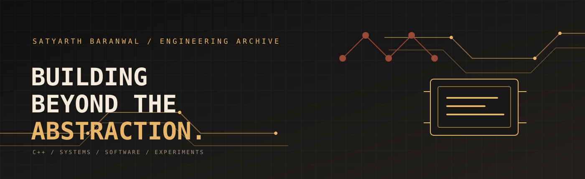
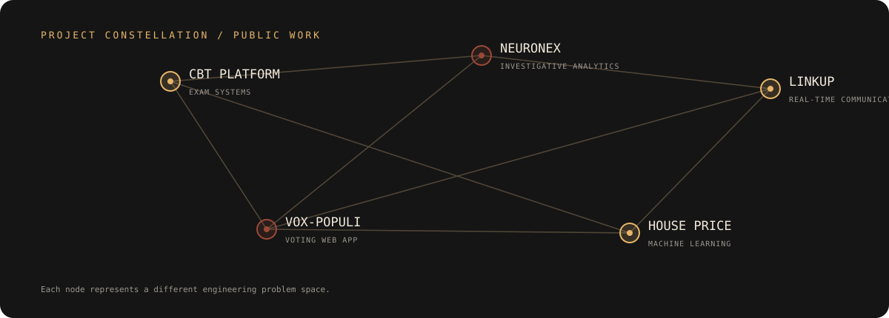
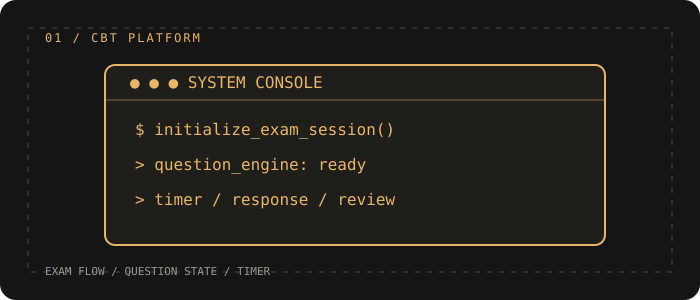
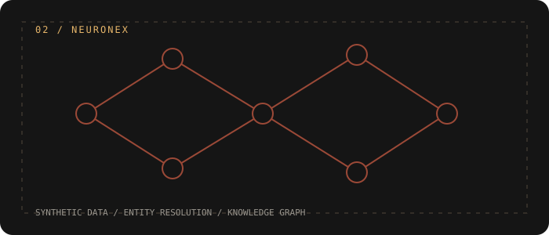
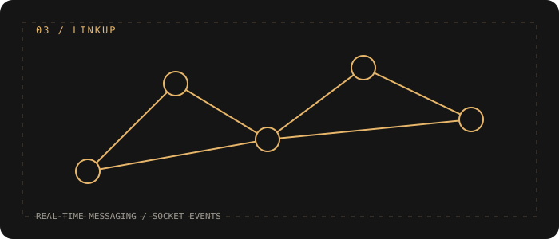
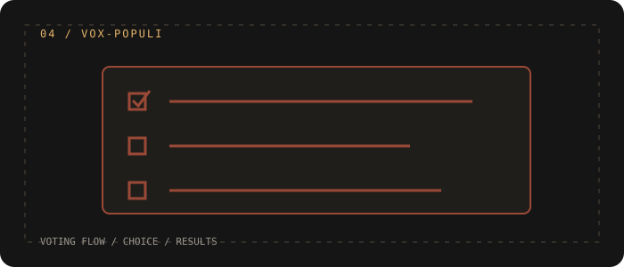
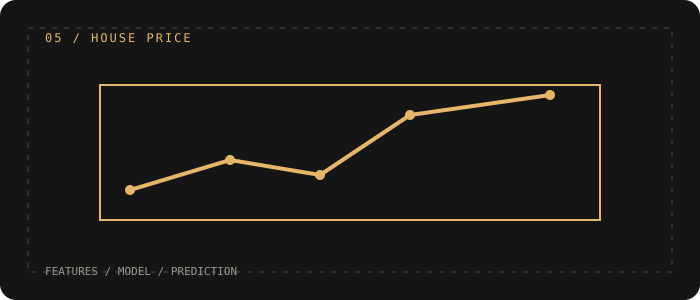

<div align="center">



<br/>

<samp>COMPUTER SCIENCE • SOFTWARE ENGINEERING • SYSTEMS CURIOSITY</samp>

<br/><br/>


</div>

---

## `00 / INDEX`

**I build software to understand the systems beneath it.**

I'm Satyarth, a Computer Science undergraduate focused on C++, data structures and algorithms, systems engineering, and practical software development. I like projects where the interesting part is not only the interface, but also the data flow, execution model, algorithms, and engineering decisions behind it.

> Current direction: deeper C++ fundamentals, operating systems, networking, performance, and reliable software design.

<div align="center">
  
</div>

## `01 / SELECTED WORKS`

<table>
<tr>
<td width="50%" valign="top">



### 01 — CBT Exam Platform

**JEE-style computer-based examination platform**

A browser-based examination experience designed around JEE-style test workflows. The project is deployed.

`TypeScript` · `React` · `Web Engineering`

[Repository →](https://github.com/Satyarth-11/cbt-exam-platform)

</td>
<td width="50%" valign="top">



### 02 — NeuroNex

**Synthetic-data investigative analytics prototype · SIH 2026 problem statement**

A prototype demonstrating an end-to-end pipeline over entirely synthetic data modeled on seven investigative source types: FIRs/police reports, CDRs, financial transactions, surveillance reports, social-media intelligence, criminal-history databases, and intelligence-agency reports.

The pipeline demonstrates ingestion, NLP, entity resolution, knowledge graphs, and analytics.

`Python` · `NLP` · `Entity Resolution` · `Knowledge Graphs`

[Repository →](https://github.com/Satyarth-11/NeuroNex)

<sub>Important: This codebase uses generated synthetic data only. It does not access, contain, or reference real restricted investigative records. Public schema context: NCRB Crime in India reports and CCTNS documentation.</sub>

</td>
</tr>
<tr>
<td width="50%" valign="top">



### 03 — LinkUp

**Real-time communication platform**

A chat application featuring private and group conversations, anonymous messaging, and random matching.

`JavaScript` · `Socket.IO` · `MongoDB` · `JWT`

[Repository →](https://github.com/Satyarth-11/LinkUp) · [Live demo →](https://link-up-nine-umber.vercel.app/)

</td>
<td width="50%" valign="top">



### 04 — VOX-POPULI

**A simple web-based voting application**

A lightweight website built around a straightforward voting experience.

`HTML` · `Web Development`

[Repository →](https://github.com/Satyarth-11/VOX-POPULI)

</td>
</tr>
<tr>
<td width="50%" valign="top">



### 05 — House Price Prediction

**Machine-learning-based price estimation**

A web application that uses a trained Ridge Regression model to estimate house prices from property features.

`Python` · `Flask` · `Scikit-learn` · `Ridge Regression`

[Repository →](https://github.com/Satyarth-11/house-price-prediction) · [Live demo →](https://house-price-prediction-wheat-phi.vercel.app/)

</td>
<td width="50%" valign="top">

### 06 — Current engineering interests

**The work behind the work**

- Modern C++ and object lifetime
- Memory management and RAII
- Operating systems and Linux
- Concurrency and networking
- Data structures and algorithmic optimization
- Databases and infrastructure

</td>
</tr>
</table>

## `02 / TOOLBOX`

<div align="center">


</div>

## `03 / IN THE LAB`

```text
[ STUDYING ]  Modern C++ — ownership, RAII, move semantics
[ EXPLORING ] Operating systems, processes, threads, memory
[ PRACTICING ] Data structures, algorithms, contest problem solving
[ BUILDING ]   Projects that expose the engineering beneath the UI
```

## `04 / GITHUB SIGNAL`

<div align="center">


</div>

<div align="center">
  
</div>

## `05 / FIND ME`

<div align="center">

[](https://github.com/Satyarth-11)
[](https://www.linkedin.com/)

</div>

---

<div align="center">
  <samp>MAKE IT WORK. UNDERSTAND WHY. MAKE IT BETTER.</samp>
  <br/>
  <sub>Designed as an engineering archive · Graphite / Amber / Archive Cream / Oxide</sub>
</div>
